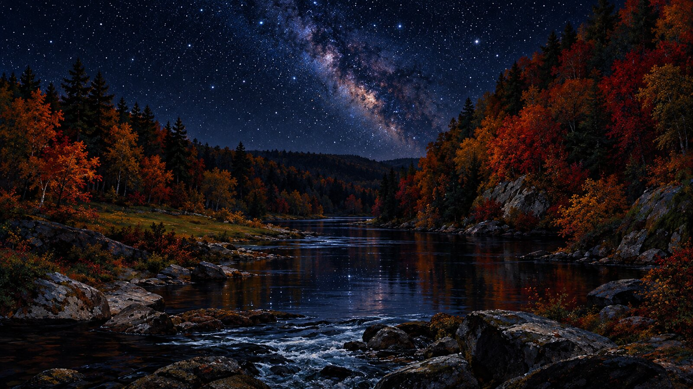
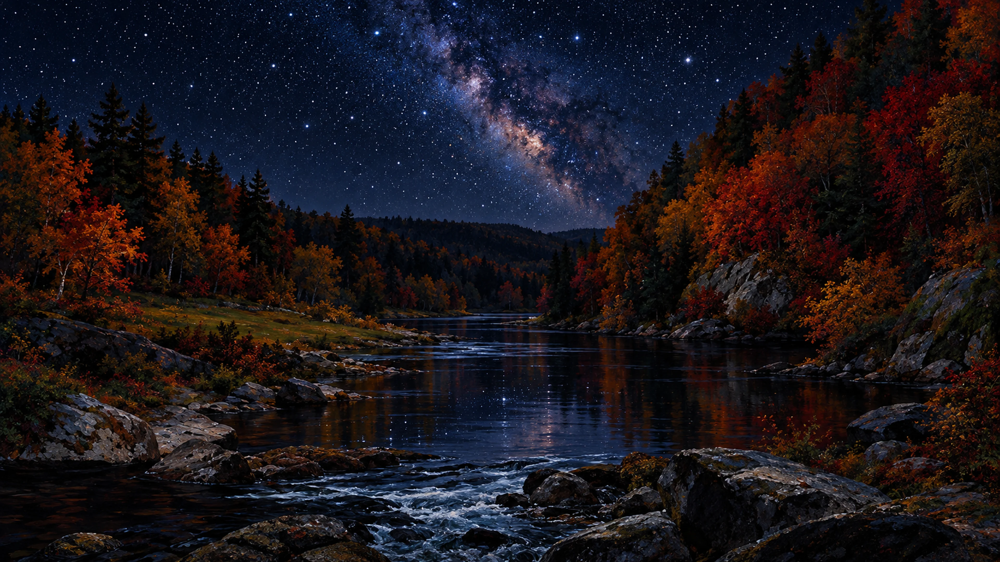
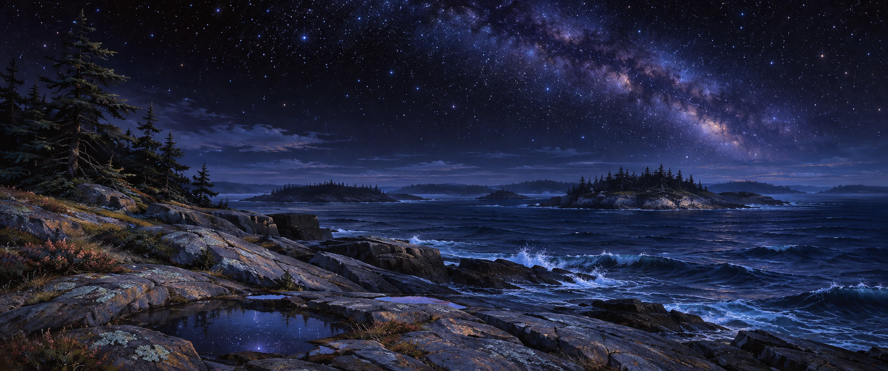
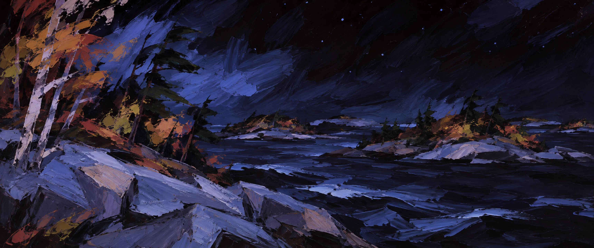
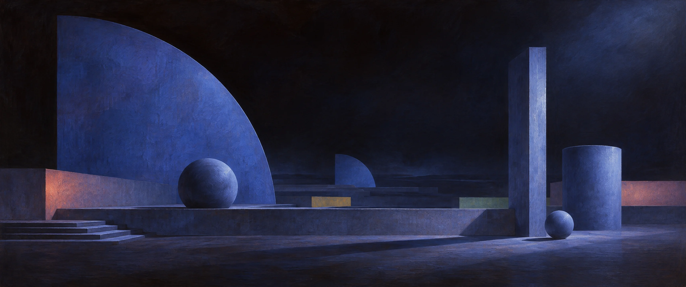
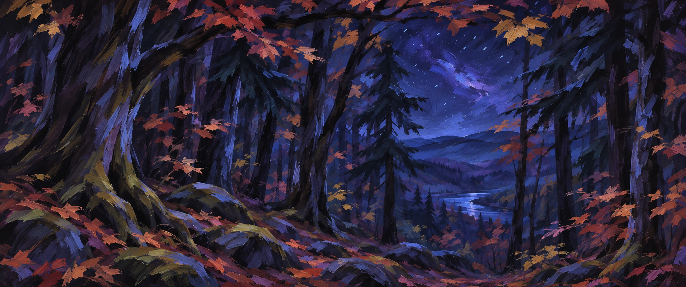

# Maine Autumn Dark — Omarchy theme



## Backgrounds

| | | |
|---|---|---|
| <a href="backgrounds/1-starry-autumn-river-night.webp"></a><br><sub>Original source</sub> | <a href="backgrounds/2-night-time-costal-island-maine.webp"></a><br><sub>Made with <a href="https://github.com/lutzlstein/oma-easel">Oma Easel</a></sub> | <a href="backgrounds/4-restyle-as-expressionist-broad-brush.webp"></a><br><sub>Made with <a href="https://github.com/lutzlstein/oma-easel">Oma Easel</a></sub> |
| <a href="backgrounds/5-bauhaus.webp"></a><br><sub>Made with <a href="https://github.com/lutzlstein/oma-easel">Oma Easel</a></sub> | <a href="backgrounds/6-same-scene-from-perspetive-forest.webp"></a><br><sub>Made with <a href="https://github.com/lutzlstein/oma-easel">Oma Easel</a></sub> |  |

## Install

```
omarchy-theme-install https://github.com/lutzlstein/omarchy-maine-autumn-dark-theme
```

Aether (adds it to your blueprints and applies it):

```
aether --import-blueprint https://raw.githubusercontent.com/lutzlstein/omarchy-maine-autumn-dark-theme/main/blueprint.json --auto-apply
```

## Palette

| Name | Hex | Swatch |
|---|---|---|
| accent | `#6c8af1` |  |
| selection | `#242471` |  |
| selection_foreground | `#7a99ff` |  |
| muted | `#68615e` |  |
| background | `#070201` |  |
| dark_background | `#050201` |  |
| darker_background | `#040101` |  |
| lighter_background | `#201b1a` |  |
| foreground | `#e5e2f4` |  |
| dark_foreground | `#acaab7` |  |
| light_foreground | `#e9e6f6` |  |
| bright_foreground | `#ece9f7` |  |
| red | `#e29480` |  |
| yellow | `#edc37e` |  |
| orange | `#e6a493` |  |
| green | `#ccc965` |  |
| cyan | `#abbdff` |  |
| blue | `#94abee` |  |
| magenta | `#a0acf1` |  |
| brown | `#8a6258` |  |
| bright_red | `#ffb49a` |  |
| bright_yellow | `#ffce53` |  |
| bright_green | `#e7e256` |  |
| bright_cyan | `#b2c5ff` |  |
| bright_blue | `#b3c9ff` |  |
| bright_magenta | `#bec8ff` |  |

Icons: `Yaru-blue`

## Backgrounds credits

- `1-starry-autumn-river-night.webp`: AI-generated with ChatGPT by Cory Blische, Oct 16 2026.

### Made with Oma Easel

These backgrounds were generated by Cory Blische with [Oma Easel](https://github.com/lutzlstein/oma-easel), in the style and colors of this theme's original background.

- `2-night-time-costal-island-maine.webp`: made with Oma Easel using Codex's image tool, from the prompt “night time costal island maine landscape in this pallet”.
- `4-restyle-as-expressionist-broad-brush.webp`: made with Oma Easel using Codex's image tool, from the prompt “restyle as expressionist. broad brush strokes, verging on abstraction. blend both current candidates”.
- `5-bauhaus.webp`: made with Oma Easel using Codex's image tool, from the prompt “bauhaus”.
- `6-same-scene-from-perspetive-forest.webp`: made with Oma Easel using Codex's image tool, from the prompt “same scene from perspetive of forest interior, river in distance”, then refined with “more expressionistic, less d&d background”.

The background images are released under the same MIT license as the rest of this theme.

## License

MIT, see [LICENSE](LICENSE).
